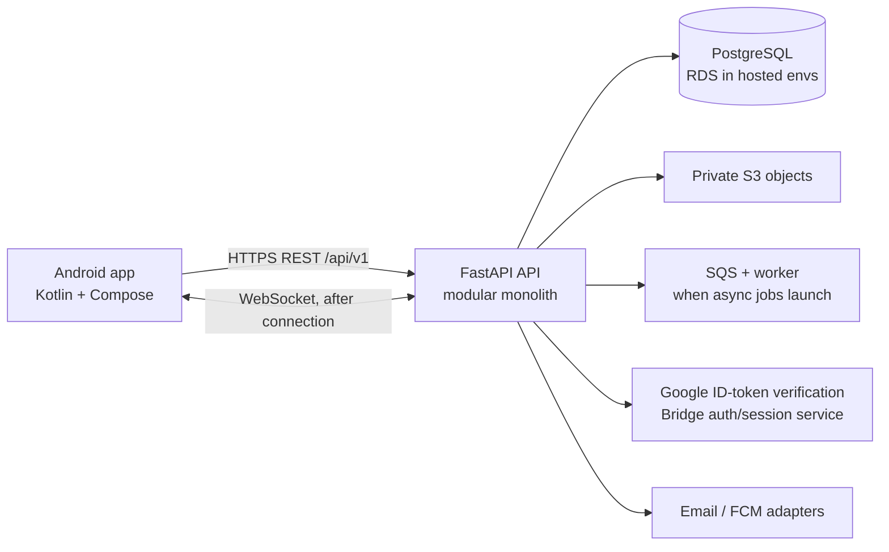

# Bridge architecture

**Status:** Approved foundation architecture. Feature implementations remain subject to phase approval.

## System shape

Bridge uses a native Android client and a modular-monolith API. The API owns identity-to-Bridge-user mapping, authorization, privacy, quotas, scoring, and all product rules. Provider SDKs live behind adapters so the product can change vendors without moving business logic into clients or provider-specific functions.

## Android

- Kotlin, one Activity, Jetpack Compose, Material 3, Navigation Compose.
- MVVM with Clean Architecture boundaries: UI and ViewModels expose immutable screen state; domain rules are independent of Compose; repositories mediate network and safe local storage.
- Gradle Kotlin DSL and version catalog. Build flavors `dev`, `stag`, and `prod`; distinct application IDs and runtime configuration.
- Hilt, Retrofit/OkHttp, Kotlin serialization, Coroutines/Flow, Room, DataStore, Coil, WorkManager, FCM, and Android Keystore-backed token handling as features require them.
- Initial modules: `:app`, `:core:designsystem`, and `:feature:onboarding`. Feature modules grow along the approved boundaries; no network or business logic inside Composables.
- Material 3 and Bridge design tokens are used instead of CSS. The supplied flow and brand sheet are retained as references in `assets/reference/`; the initial Compose mark is a foundation approximation, and the production app icon/export must be checked against the approved original logo before release.

## Backend

- Python 3.12+, FastAPI, versioned REST API at `/api/v1`, Pydantic v2 request/response validation.
- SQLAlchemy 2.x and Alembic against PostgreSQL. Async jobs are handled by a worker and managed queue when introduced; no long-running work in request handlers.
- Domain packages own distinct areas (`auth`, `profiles`, `discover`, `connections`, `messages`, `cohorts`, `pods`, `referrals`, `moderation`, and `privacy`). Cross-domain workflows go through application services.
- PostgreSQL full-text search and indexes for MVP. No Redis, microservices, Kubernetes, Kafka, or OpenSearch at foundation.
- Auth sessions and account authorization are owned by FastAPI. Google is the native sign-in identity provider; Google ID tokens are verified on the server and exchanged for Bridge sessions. Email/password accounts use Argon2id password hashes and the same Bridge session service. Email, provider connections, private storage, push, and job enqueueing sit behind adapters.

## Deployment target

The approved baseline is AWS-first in `ap-south-1`, with ECS Fargate, ECR, RDS PostgreSQL, private S3, SQS, Secrets Manager/KMS, CloudWatch, and VPC/IAM/network controls. `dev`, `stag`, and `prod` have isolated identities, data stores, buckets, queues, credentials, logs, and deployment permissions. Terraform is the source of infrastructure state. Google handles initial Google identity proof; Bridge issues its own opaque, expiring, rotating sessions stored as hashes in PostgreSQL. Cognito is not the MVP session issuer. No cloud resources are provisioned in this phase.

## Security boundaries

- Authenticate tokens at the API boundary; authorize every object access on the server.
- Keep profile visibility, resume access, group membership, chat eligibility, referral quota, and Bridge Score calculation server-enforced.
- Do not log access tokens, resumes, private messages, or sensitive profile content.
- Use short-lived signed object URLs, file validation, least-privilege IAM, TLS, secret manager injection, and isolated environment credentials.
- Use synthetic data outside production. Clear account-scoped local data at logout/account switch.

## Failure handling and observability

Network-backed screens will receive explicit loading, empty, offline, retry, error, and success states. API requests use correlation IDs and structured logs with an environment label. Readiness checks database connectivity; liveness does not depend on downstream services. Sentry/OpenTelemetry are added behind configuration and privacy review.

## Architecture decisions

The corresponding rationale, open dependencies, and approval gates are recorded in [assumptions-and-decisions.md](assumptions-and-decisions.md) and [provider-integration-limitations.md](provider-integration-limitations.md).
